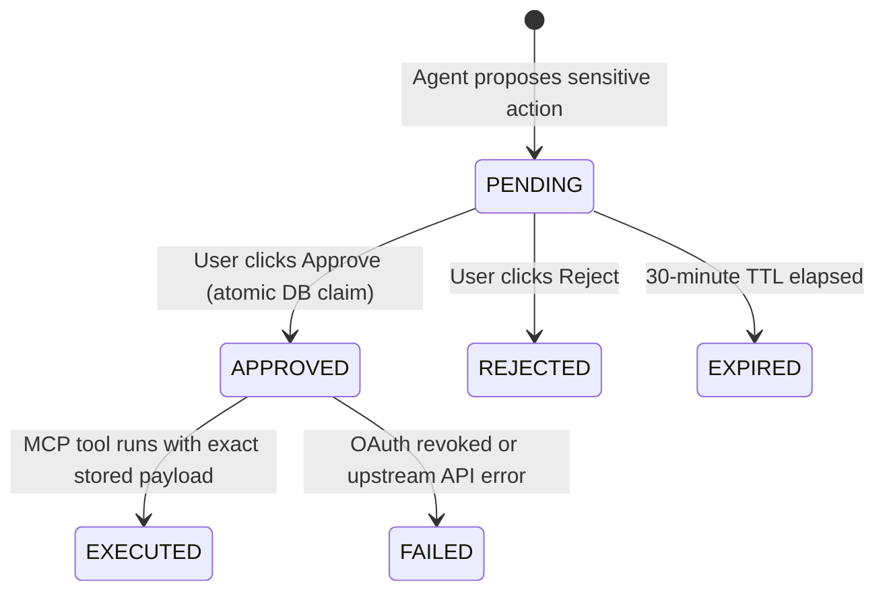

# Agentic Workflows & Human Approval Lifecycle

LifeDesk AI combines native tools (`tasks`, `memories`, `reminders`, `preferences`) with external MCP tools (`gmail`, `calendar`) inside a bounded multi-step loop (`MAX_TOOL_ITERATIONS = 5`).

---

## 1. Human Approval Lifecycle

Sensitive external mutations (`gmail_send_email`, `calendar_create_event`, `calendar_update_event`, `calendar_delete_event`) **never execute during the LLM tool loop**.

Safety guarantees:
- **Payload immutability:** `action_payload` is frozen at staging time; `POST /api/approvals/{id}/approve` accepts no body edits.
- **Edit Draft flow:** Clicking **Edit Draft** in the UI rejects the old `PENDING` approval and creates a brand-new proposal requiring fresh approval.
- **No replay:** `ApprovalRepository.transition_to_approved()` atomically updates `PENDING -> APPROVED` (`WHERE status = 'PENDING'`), preventing double clicks or replay attacks.

---

## 2. Core Agentic Workflows

### Workflow A: Email to Calendar
Prompt: *"Find the email from Rahul about tomorrow's meeting and add it to my calendar."*
1. Agent calls `gmail_search_emails(query="from:rahul meeting")`.
2. Agent calls `gmail_get_email(message_id=...)` to read the extracted date/time. *(If date or time is missing, the agent asks the user instead of guessing.)*
3. Agent calls `calendar_find_conflicts(start_datetime, end_datetime)`.
4. Agent calls `calendar_create_event(...)`, which stages a `PENDING` approval card.
5. User reviews the proposed event card in the UI and clicks **Approve**.
6. Backend executes `calendar_create_event` via the Calendar MCP server and marks the approval `EXECUTED`.

### Workflow B: Daily Briefing (Read-Only)
Prompt: *"Give me my daily briefing."*
1. Agent reads today's events via `calendar_list_events`.
2. Agent searches recent emails via `gmail_list_recent_emails`.
3. Agent retrieves pending tasks via `list_tasks(status="pending")` and preferences via `retrieve_memory`.
4. Agent synthesizes a concise briefing without mutating any external service.

### Workflow C: Email Drafting
Prompt: *"Draft a reply to Rahul confirming the meeting."*
1. Agent searches and reads Rahul's thread (`gmail_search_emails` → `gmail_get_thread` / `gmail_get_email`).
2. Agent generates a context-aware reply and calls `gmail_create_draft(to, subject, body)`.
3. Draft is saved in Gmail without sending; the agent confirms the draft is ready for review.

### Workflow D: Task Scheduling
Prompt: *"Schedule my pending tasks across my free time tomorrow."*
1. Agent calls `list_tasks(status="pending")` and `get_user_preferences()`.
2. Agent calls `calendar_check_availability(start_datetime, end_datetime)` for tomorrow.
3. Agent computes open slots and either asks about missing task durations or proposes clearly labeled blocks via `calendar_create_event` approval cards.
4. Events are created only after the user approves them.
