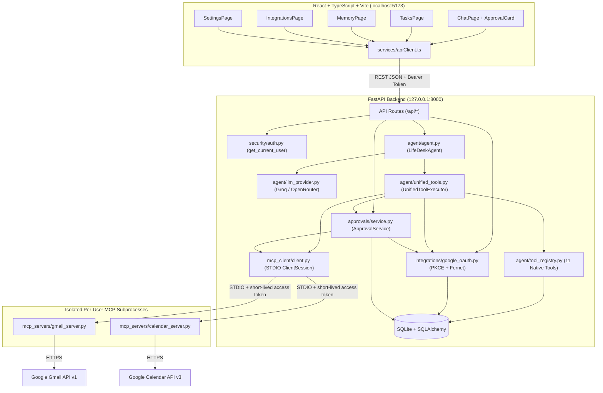
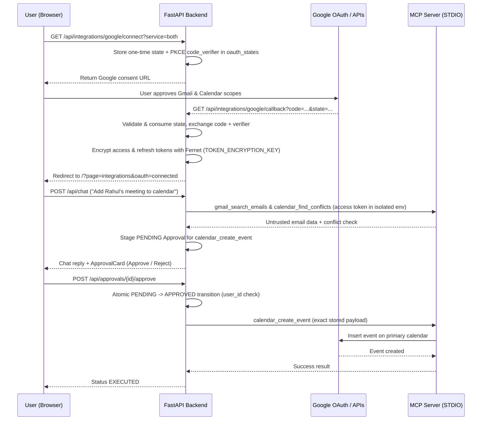

# LifeDesk AI — System Architecture

LifeDesk AI is designed as a modular, multi-user Personal AI Chief of Staff combining **native application tools** with **Model Context Protocol (MCP)** integrations and **human-in-the-loop approvals**.

---

## 1. High-Level System Diagram

---

## 2. Frontend Architecture

- **`src/services/apiClient.ts`**: Single HTTP gateway attaching `Authorization: Bearer <token>` when a user session token is active, never storing Google credentials.
- **`src/hooks/useLifeDeskData.ts`**: Synchronizes tasks, memories, conversations, integrations, approvals, user profiles, and backend health.
- **Pages**:
  - `ChatPage.tsx`: Displays conversation history, real tool-execution status (`ToolCallList.tsx`), and interactive approval cards (`ApprovalCard.tsx`).
  - `TasksPage.tsx` & `MemoryPage.tsx`: Full CRUD backed by SQLite.
  - `IntegrationsPage.tsx`: Displays Gmail & Google Calendar connection state, OAuth callbacks, and planned Coming Soon integrations.
  - `SettingsPage.tsx`: Displays LLM provider status, timezone settings, and local user profile switching.

---

## 3. Backend Architecture & Layer Separation

1. **API Layer (`backend/app/api/routes/`)**: Validates HTTP payloads with Pydantic, resolves the authenticated user via `Depends(get_current_user)`, applies sliding-window rate limiting on sensitive endpoints, and maps domain exceptions to HTTP status codes.
2. **Agent Orchestration (`backend/app/agent/agent.py`)**: Runs a bounded loop (`max_tool_iterations = 5`), preserves conversation history in SQLite, injects timezone context, defends against prompt injection from external data, and passes unified tool schemas to the LLM.
3. **LLM Provider (`backend/app/agent/llm_provider.py`)**: Uses `openai.OpenAI` with provider-specific `base_url` (`https://api.groq.com/openai/v1` or `https://openrouter.ai/api/v1`) without hardcoding secrets or silently switching to paid models.
4. **Unified Tool Abstraction (`backend/app/agent/unified_tools.py`)**: Presents native and MCP tools identically to the LLM while preserving `source`, `provider`, `required_scopes`, `requires_approval`, and Pydantic argument validation.
5. **MCP Layer (`backend/app/mcp_client/` + `backend/app/mcp_servers/`)**: Uses `mcp==2.3.0` (`MCPServer`, `stdio_client`, `ClientSession`) to isolate Google API calls in dedicated subprocesses per user invocation.
6. **Database Layer (`backend/app/database/`)**: SQLAlchemy 2.x ORM models and user-scoped repositories with non-destructive SQLite schema migrations on startup.

---

## 4. Google OAuth & Approval Execution Sequence

---

## 5. Database Schema Design

All user-owned tables include `user_id` with foreign-key constraints:
- `users`: `id`, `name`, `email`, `timezone`, `created_at`
- `tasks`: `id`, `user_id`, `title`, `description`, `due_date`, `status`, `created_at`, `updated_at`
- `reminders`: `id`, `user_id`, `task_id`, `title`, `remind_at`, `status`, `created_at`
- `conversations`: `id`, `user_id`, `title`, `created_at`, `updated_at`
- `messages`: `id`, `conversation_id`, `role`, `content`, `tool_metadata`, `created_at`
- `memories`: `id`, `user_id`, `key`, `value`, `created_at`, `updated_at` (`UNIQUE(user_id, key)`)
- `integrations`: `id`, `user_id`, `provider`, `account_email`, `status`, `granted_scopes`, `last_connected_at` (`UNIQUE(user_id, provider)`)
- `integration_credentials`: `id`, `integration_id`, `encrypted_access_token`, `encrypted_refresh_token`, `token_expiry`, `encryption_version`
- `oauth_states`: `id`, `state`, `user_id`, `service`, `requested_scopes`, `code_verifier`, `expires_at`
- `approvals`: `id`, `user_id`, `conversation_id`, `provider`, `tool_name`, `action_type`, `action_payload`, `summary`, `status`, `expires_at`, `approved_at`, `executed_at`, `execution_result`
- `tool_executions`: `id`, `user_id`, `conversation_id`, `tool_name`, `tool_source`, `status`, `duration_ms`, `safe_error_summary`, `created_at`
