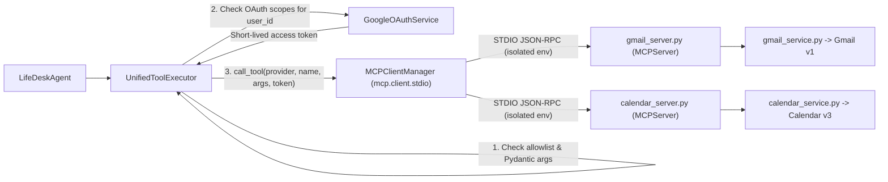

# Model Context Protocol (MCP) Guide

LifeDesk AI uses a **hybrid architecture**: native Python tool calling for internal app features and the **Model Context Protocol (MCP)** (`mcp==2.3.0`) for external integrations.

---

## 1. What Is MCP & Why LifeDesk Uses It

**Model Context Protocol (MCP)** is an open standard that separates *AI agent orchestration* (the MCP client) from *external service adapters* (MCP servers). Instead of hardcoding Gmail and Calendar SDK logic inside `agent.py`, LifeDesk exposes external services through isolated MCP servers communicating over JSON-RPC.

### Native Tools vs. MCP Tools

| Aspect | Native Tools (`tool_registry.py`) | MCP Tools (`mcp_servers/` + `mcp_client/`) |
|---|---|---|
| Purpose | Internal LifeDesk state (tasks, reminders, memories, preferences) | External systems (Gmail, Google Calendar, future Drive/Web/Notion/Slack) |
| Execution | Direct in-process Python function using SQLAlchemy `Session` | Isolated subprocess spawned via `mcp.client.stdio.stdio_client` + `ClientSession` |
| Auth Boundary | Authenticated LifeDesk `user.id` | Per-user decrypted short-lived OAuth access token passed only to that user's subprocess env |
| Agent Visibility | Unified tool definition via `UnifiedToolExecutor` | Identical OpenAI tool schema via `UnifiedToolExecutor` |

---

## 2. MCP Client & Server Architecture

### MCP Servers Implemented
- **`backend/app/mcp_servers/gmail_server.py`** (`MCPServer("lifedesk-gmail")`):
  - `gmail_search_emails(query, max_results)`
  - `gmail_get_email(message_id)`
  - `gmail_list_recent_emails(max_results)`
  - `gmail_get_thread(thread_id)`
  - `gmail_create_draft(to, subject, body)`
  - `gmail_send_email(to, subject, body, thread_id)` *(approval-gated before reaching MCP)*
- **`backend/app/mcp_servers/calendar_server.py`** (`MCPServer("lifedesk-calendar")`):
  - `calendar_list_calendars()`
  - `calendar_list_events(start_datetime, end_datetime)`
  - `calendar_get_event(event_id)`
  - `calendar_check_availability(start_datetime, end_datetime)`
  - `calendar_find_conflicts(start_datetime, end_datetime)`
  - `calendar_create_event(...)` *(approval-gated)*
  - `calendar_update_event(...)` *(approval-gated)*
  - `calendar_delete_event(event_id)` *(approval-gated)*

---

## 3. Tool Discovery & Execution

### Discovery
`MCPClientManager.discover_tools(provider)` spawns the target MCP server over STDIO, calls `await session.initialize()`, and invokes `await session.list_tools()` to inspect `name`, `description`, and `input_schema` (`mcp==2.3.0`).

### Execution & Per-User Authorization
1. The LLM **never** supplies `user_id` or OAuth tokens as tool arguments.
2. `UnifiedToolExecutor.execute()` receives the authenticated FastAPI `User`, validates tool arguments with Pydantic (`extra="forbid"`), and verifies required Google scopes for `user.id`.
3. If `requires_approval=True`, execution stops and creates a `PENDING` record in `approvals`.
4. Otherwise, `MCPClientManager.call_tool()` launches an isolated subprocess containing **only** `PATH`, `PYTHONPATH`, `LIFEDESK_USER_TIMEZONE`, and `LIFEDESK_GOOGLE_ACCESS_TOKEN` (never the refresh token or unrelated server secrets like `GROQ_API_KEY`).

---

## 4. Error Handling

- **Missing / Disconnected Integration:** Returns `error_code="integration_required"` so the agent instructs the user to connect Google on `/integrations`.
- **Expired / Revoked Token:** `GoogleOAuthService` refreshes automatically; if revoked (`invalid_grant`), marks the integration `needs_reconnect` and surfaces a clear reconnect prompt.
- **MCP Process / Transport Errors:** Caught as `MCPClientError`, logged safely to `tool_executions`, and returned as structured JSON errors to the agent.

---

## 5. Adding Another MCP Server in the Future

1. Create `backend/app/mcp_servers/<name>_server.py` using `from mcp.server.mcpserver import MCPServer`.
2. Register the module path in `MCP_SERVER_MODULES` inside `backend/app/mcp_client/client.py`.
3. Add Pydantic argument schemas and `UnifiedToolDefinition` entries in `backend/app/agent/unified_tools.py` (set `requires_approval=True` for any external mutation).
4. If OAuth is needed, store credentials per user in `integrations` + `integration_credentials` and map approval policies in `APPROVAL_MCP_POLICIES` (`backend/app/approvals/service.py`).
